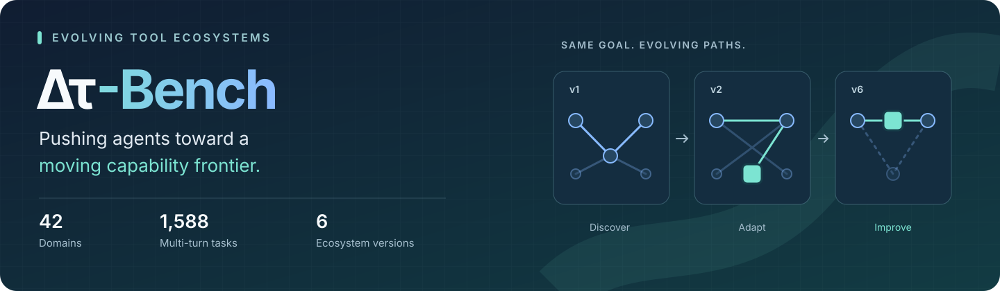
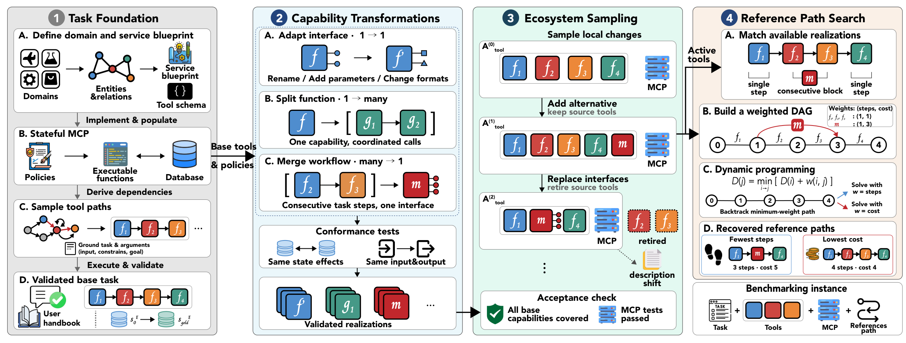
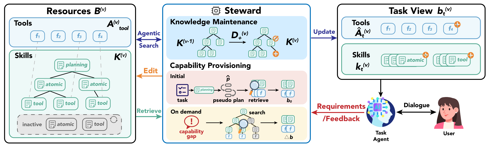

<div align="center">



<br />

**An executable benchmark for agents that discover, adapt, and improve as tools evolve.**

Multi-turn tasks · Stateful environments · Versioned tools · Outcome-based evaluation

[Overview](#overview) · [Installation](#installation) · [Dataset](#dataset) · [Configuration](#configuration)<br />
[Model-only Baseline](#baseline) · [Steward](#steward) · [Evaluation](#evaluation) · [Practical Guide](#practical-guide)<br />
[Citation](#citation) · [License](#license)

</div>

---

<a id="overview"></a>
## 01 · Benchmark overview

**Δτ-Bench** evaluates how agents keep pace with changing tool ecosystems. User goals stay fixed while interfaces change, functions split, workflows merge, and alternative tools become available amid overlapping functionality and noisy descriptions. Agents must complete the task, recover from disrupted workflows, and discover more efficient ways to act.

This repository provides the **model-only baseline**, **Steward**, and the **replay-based evaluator**. The executable dataset is distributed separately and can be downloaded directly into `data/`.

<p align="center">
  
  <br />
  <sub>Benchmark construction, from the accompanying paper (Figure 2). Click the image to inspect the full-resolution diagram.</sub>
</p>

| Stateful tasks | Evolving capabilities | Adaptation-aware evaluation |
| :--- | :--- | :--- |
| **1,588 tasks** across **42 domains**, with executable services and databases. | **Six successive versions**, with interface adaptation, function splitting, and workflow merging. | Measure **task success**, **tool retrieval**, and **path efficiency**, including adaptation across versions. |

| Training tasks | Test tasks per version | Evaluation versions | Retained reference environment |
| :---: | :---: | :---: | :---: |
| 1,191 | 397 | `v1` → `v6` | `base` |

> **Getting started:** install the package → download the dataset → configure chat and embedding services → run the [baseline](#baseline) or [Steward](#steward). The entry scripts build indices, run tasks, and generate evaluation reports.

<a id="installation"></a>
## 02 · Installation

**Python 3.10+ · Bash · CPU-compatible benchmark runner**

Clone this repository and run the following commands from its root. All commands in this guide assume that working directory.

```bash
python -m venv .venv
source .venv/bin/activate
python -m pip install --upgrade pip
python -m pip install .
python -m dtau_bench --help
```

The default installation calls chat and embedding services over HTTP. It does not require a local GPU or install PyTorch. Model hosting is configured separately; the runner does not start model servers.

<details>
<summary><strong>Optional: a Conda environment or a development installation</strong></summary>

Use Conda in place of the virtual-environment commands above:

```bash
conda create -n dtau-bench python=3.12 -y
conda activate dtau-bench
python -m pip install .
```

For editable source and the offline test suite:

```bash
python -m pip install -e '.[test]'
python -m pytest -q
```

</details>

<a id="dataset"></a>
## 03 · Prepare the dataset

### Download into `data/`

Download the **whole benchmark bundle** from [zjunlp/delta-tau-bench on Hugging Face](https://huggingface.co/datasets/zjunlp/delta-tau-bench), including its executable services and evaluation metadata.

```bash
python -m pip install --upgrade huggingface_hub
hf download zjunlp/delta-tau-bench \
  --repo-type dataset \
  --local-dir ./data

export DTAU_BENCH_DATA_ROOT=./data
python -m dtau_bench validate-data
python -m dtau_bench rollout --run-name inspect --list --split test
```

The resulting layout should be:

```text
dtau-bench/
├── configs/
├── scripts/
├── src/
└── data/
    ├── tasks/                  # 1,191 train + 397 test tasks
    ├── tools/                  # Tool catalogs for base and v1–v6
    ├── servers/                # Executable environment implementations
    ├── database/               # Initial entities and relationships
    ├── meta/                   # Evolution, tool costs, evaluation rules
    └── checksums.sha256        # Integrity manifest
```

`data/` means the directory inside this repository. The five component directories must sit directly inside it. `validate-data` checks JSON, task identities, references, and checksums when the manifest is present; it does not run the reference trajectories.

<details>
<summary><strong>Already have the bundle, or prefer a separate data directory?</strong></summary>

For a bundle stored alongside this repository, copy its components into `data/`:

```bash
mkdir -p data
cp -R ../dataset/{tasks,tools,servers,database,meta} ./data/
cp ../dataset/checksums.sha256 ./data/
export DTAU_BENCH_DATA_ROOT=./data
python -m dtau_bench validate-data
```

To use it without copying, set `DTAU_BENCH_DATA_ROOT=../dataset` in your `.env` instead. After loading the configuration below, run `validate-data` again. An absolute path to a separate bundle is also supported.

Data resolution uses an explicit `--data-dir` where supported, then `DTAU_BENCH_DATA_ROOT`, then the repository's `data/`. The variable must point to the bundle root, not to `tasks/` or an individual JSON file.

</details>

The released dataset has undergone additional verification and corrections beyond the original version used for the experiments in the paper. Results obtained with this release may therefore differ numerically from those reported in the paper, while the main experimental conclusions remain unchanged.

<a id="configuration"></a>
## 04 · Configure models and embeddings

The experiment uses three services:

| Service | Role | Default model profile / ID |
| :--- | :--- | :--- |
| **Agent** | Plans actions and calls tools; also powers Steward maintenance by default. | `deepseek-v4-pro` |
| **Simulated user** | Conducts the multi-turn task dialogue. | `deepseek-flash` |
| **Embedding** | Encodes tools and skills for retrieval, clustering, and indexing. | `Qwen3-Embedding-0.6B` |

### 1 · Set chat endpoints and credentials

Create your local configuration:

```bash
cp .env.example .env
```

Edit `.env` with your served model IDs, endpoint URLs, and credentials. For example:

```dotenv
DTAU_BENCH_DATA_ROOT=./data

DTAU_AGENT_MODEL=deepseek-v4-pro
DTAU_AGENT_BASE_URL=https://your-chat-endpoint.example/v1
DTAU_AGENT_API_KEY=YOUR_AGENT_API_KEY

DTAU_USER_MODEL=deepseek-flash
DTAU_USER_BASE_URL=https://your-chat-endpoint.example/v1
DTAU_USER_API_KEY=YOUR_USER_API_KEY

DTAU_EMBEDDING_MODEL=Qwen3-Embedding-0.6B
DTAU_EMBEDDING_BASE_URL=http://localhost:8009/v1
DTAU_EMBEDDING_API_KEY=EMPTY
```

The URLs above are examples. Use separate URLs and keys when the two chat models use different providers. For an authenticated embedding service, replace `EMPTY` with its API key.

Load the file in every new shell before starting an experiment:

```bash
set -a
source .env
set +a
```

> **Configuration:** `.env` is ignored by Git and is **not loaded automatically**. Keep real credentials there. [`configs/models.yaml`](configs/models.yaml) defines request options; the two default chat profiles use `reasoning_effort: high`. The agent endpoint must support function calling. When changing model families, adjust supported request options and token limits in that file.

<details>
<summary><strong>Served model IDs vs. configuration profile keys</strong></summary>

`DTAU_AGENT_MODEL` and `DTAU_USER_MODEL` set the model IDs sent to your service. You can change them while retaining the existing YAML profile keys.

`AGENT_MODEL`, `USER_MODEL`, and `EVOLVE_MODEL` in the shell scripts select **keys under `models:`** in `configs/models.yaml`. CLI options such as `--agent-model` also select these keys. Add the corresponding YAML profiles before selecting new keys:

```bash
AGENT_MODEL=my_agent USER_MODEL=my_user EXP_NAME=baseline_custom \
  bash scripts/run_baseline.sh
```

For Steward, `EVOLVE_MODEL` defaults to the selected agent profile. Set it separately to use another model for skill maintenance.

</details>

### 2 · Configure the embedding service

**Use an OpenAI-compatible HTTP embedding endpoint for the complete baseline and Steward workflows.** It can run remotely or on a separate CPU/GPU service. Set the model ID to the name actually served by that endpoint; the default `localhost:8009` address assumes you have already started such a service.

The supplied configuration is:

```yaml
embedding:
  default:
    backend: openai_http
    model: "${DTAU_EMBEDDING_MODEL:-Qwen3-Embedding-0.6B}"
    base_url: "${DTAU_EMBEDDING_BASE_URL:-http://localhost:8009/v1}"
    api_key: "${DTAU_EMBEDDING_API_KEY:-EMPTY}"
    batch_size: 8
    request_timeout: 600
    max_retries: 2
    retry_delay: 1
```

Once the endpoint is ready, build and validate one tool index to verify the configuration:

```bash
python -m dtau_bench build-tool-index --version v1 --batch-size 8
python -m dtau_bench build-tool-index --version v1 --validate-only
```

This step makes embedding requests. The experiment scripts perform the same index setup automatically and reuse valid indices. Keep the embedding configuration consistent across indexing, training, and testing; rebuild tool and skill indices when changing the model or backend.

<details>
<summary><strong>Optional: local embeddings for retrieval and indexing</strong></summary>

Install the local inference dependencies:

```bash
python -m pip install '.[local-embeddings]'
```

For standalone tool/skill indexing and retrieval, replace the `embedding.default` block with:

```yaml
embedding:
  default:
    backend: local
    model: Qwen/Qwen3-Embedding-0.6B
    batch_size: 8
```

The model may also be a local model directory. Weights are downloaded on first use when a Hugging Face model ID is supplied.

**Scope:** Steward's bootstrap/evolution clustering and graph-building stages still use HTTP embeddings. Setting `backend: local` alone does not configure a complete Steward training run. Use the HTTP configuration above for the end-to-end workflow.

</details>

<a id="baseline"></a>
## 05 · Run the model-only baseline

The default baseline, `all_tools_iterative_rag`, retrieves tools iteratively from the catalog and lets the model execute the task **without a learned skill library**. Both the agent and simulated-user models use the configuration above.

**Start with one version:**

```bash
VERSIONS="v1" EXP_NAME=baseline_demo \
  bash scripts/run_baseline.sh
```

**Run the complete test set across all six versions:**

```bash
VERSIONS="v1 v2 v3 v4 v5 v6" EXP_NAME=baseline_full \
  bash scripts/run_baseline.sh
```

```text
Build / validate tool indices → Test rollouts → Replay evaluation → Metric reports
```

Each selected version runs all **397 test tasks**. A six-version run contains **2,382 task rollouts**. Reports include single-version SPE as well as cross-version adaptation metrics when multiple versions are selected.

The one-version example writes trajectories to `experiments/baseline_demo_v1_test/` and its combined report to `experiments/baseline_demo_multi_eval/`.

<a id="steward"></a>
## 06 · Run Steward

**Steward** jointly manages tools and procedural knowledge through incremental skill maintenance and dynamic resource provisioning. It maintains planning, atomic, and tool skills, tracks their dependencies, and updates the agent's available resources through retrieval and on-demand search.

<p align="center">
  
  <br />
  <sub>Steward's knowledge maintenance and capability provisioning, from the accompanying paper (Figure 5).</sub>
</p>

### 1 · Build the versioned skill libraries

```bash
VERSIONS="v1 v2 v3 v4 v5 v6" EXP_NAME=steward_full \
  bash scripts/run_steward_train.sh
```

| Stage | Training workflow |
| :--- | :--- |
| **v1 · Bootstrap** | Run training tasks with domain tools → evaluate trajectories → extract and organize skills → build retrieval indices. |
| **v2–v6 · Evolve** | Run training tasks using the preceding version's library → evaluate → update skills for the current ecosystem → rebuild indices. |

Here, training builds and maintains the skill libraries using the **training split**. It does not fine-tune the chat model's weights.

### 2 · Evaluate the learned libraries

After training finishes, run testing with the **same experiment name, version order, and model/embedding configuration**:

```bash
VERSIONS="v1 v2 v3 v4 v5 v6" EXP_NAME=steward_full \
  bash scripts/run_steward_test.sh
```

Each test version uses its corresponding library. The script runs test rollouts, replay evaluation, and metric aggregation. The combined report is written to `experiments/steward_full_multi_eval/`.

<details>
<summary><strong>Try v1 first, then resume or start a new experiment</strong></summary>

Use a separate experiment name for a one-version trial:

```bash
VERSIONS="v1" EXP_NAME=steward_demo bash scripts/run_steward_train.sh
VERSIONS="v1" EXP_NAME=steward_demo bash scripts/run_steward_test.sh
```

Train and test share `experiments/<EXP_NAME>/run_state.json`; run them sequentially. Repeating the same command resumes the chain and skips completed stages. An interrupted extraction or propagation stage may need to repeat its unfinished work.

Use a **new experiment name** when changing the version list, models, strategies, or embedding configuration. Keep the original configuration when resuming an existing run.

</details>

<a id="evaluation"></a>
## 07 · Evaluate and report results

Both entry workflows already run evaluation. The commands below are for inspecting or re-evaluating saved rollouts and **do not call chat or embedding models**.

### Replay a single version

```bash
python -m dtau_bench evaluate \
  --run-name baseline_demo_v1_test \
  --version v1 \
  --workers 2
```

The evaluator replays the canonical reference in the `base` environment and the agent trajectory in the requested version. It compares the resulting business-state changes using the task's evaluation strategy and evolution mappings. A different valid sequence can succeed when it produces the required outcome.

### Generate the metric tables

For the one-version baseline example:

```bash
python -m dtau_bench evaluate-multi \
  --experiment-name baseline_demo \
  --versions v1 \
  --rollout-pattern 'baseline_demo_{version}_test' \
  --output-dir experiments/baseline_demo_multi_eval \
  --weight-modes unit cost \
  --workers 2 \
  --report-format both
```

For the complete Steward experiment:

```bash
python -m dtau_bench evaluate-multi \
  --experiment-name steward_full \
  --versions v1 v2 v3 v4 v5 v6 \
  --rollout-pattern 'steward_full_test_{version}' \
  --output-dir experiments/steward_full_multi_eval \
  --weight-modes unit cost \
  --workers 2 \
  --report-format both
```

| Metric | What it measures |
| :--- | :--- |
| **SR ↑** | Fraction of tasks that pass the environment-state evaluation. |
| **Tool Precision / Recall / F1 ↑** | Per-task macro averages comparing the final exposed tool set with the version-specific reference tool set, for applicable retrieval strategies. |
| **Step-SPE ↑** | Success-weighted efficiency relative to the reference tool-call count. |
| **Cost-SPE ↑** | Success-weighted efficiency using the benchmark's tool-cost weights. |
| **SPE / SR ↑** | Efficiency normalized by success rate; derive this ratio from the corresponding report values when SR is nonzero. |
| **IDR ↑** | Efficiency on tasks whose reference paths become shorter or cheaper across a version transition. |
| **DAR ↑** | Efficiency on tasks whose reference paths become longer or costlier across a version transition. |

For either weighting scheme, the per-task SPE contribution is:

```text
success × min(reference_path_weight / agent_path_weight, 1)
```

`unit` counts business-tool calls; `cost` uses the dataset's tool-cost scores, not API token charges. Retrieval and exploration helpers are excluded from these path weights. SPE averages over all tasks, including failures. `SPE / SR` is a derived column and is not emitted separately by the current reporter.

**Coverage matters:** `evaluate-multi` checks the complete 397-task test roster for each version. Use `evaluate` for partial diagnostic runs. A single complete version is enough for SPE; IDR/DAR require at least two versions, and the full `v1`–`v6` sequence gives the adjacent transitions used by the benchmark.

<a id="practical-guide"></a>
## 08 · Practical guide

### Preview a run

Inspect the planned commands without model calls or generated experiment outputs:

```bash
DRY_RUN=1 VERSIONS="v1" bash scripts/run_baseline.sh
DRY_RUN=1 VERSIONS="v1" bash scripts/run_steward_train.sh
```

### Start with conservative CPU settings

The scripts default to one numerical thread per worker and small embedding batches. Increase resource settings gradually to match available RAM, CPU cores, and service capacity.

| Workload | Environment variable | Default |
| :--- | :--- | :---: |
| Baseline domain / task concurrency | `MAX_WORKERS` / `QUERY_WORKERS` | `1` / `4` |
| Baseline replay workers | `EVAL_WORKERS` | `2` |
| Steward domain / task concurrency | `ROLLOUT_DOMAIN_WORKERS` / `ROLLOUT_QUERY_WORKERS` | `1` / `4` |
| Steward replay workers | `EVALUATE_WORKERS` | `2` |
| Skill extraction batch / concurrency | `SKILL_BATCH_SIZE` / `SKILL_MAX_CONCURRENT` | `2` / `2` |
| Clustering embedding batch | `MERGE_EMBEDDING_BATCH_SIZE` | `8` |
| Index embedding batch | `EMBEDDING_BATCH_SIZE` | `8` |

For example, reduce a first baseline run to two concurrent tasks:

```bash
VERSIONS="v1" EXP_NAME=baseline_small QUERY_WORKERS=2 EVAL_WORKERS=1 \
  bash scripts/run_baseline.sh
```

Batch size and concurrency are separate controls. When resuming Steward with only resource-setting changes, add `ALLOW_RESOURCE_CHANGE_ON_RESUME=1`; retain the experiment's model, data, strategy, and version settings.

<details>
<summary><strong>Where to find trajectories, reports, and skill libraries</strong></summary>

```text
experiments/
├── baseline_demo_v1_test/
│   ├── rollouts/                       # Per-domain agent trajectories
│   ├── record_checkpoints/             # Per-task progress
│   └── evaluation/
│       ├── evaluation_results.jsonl    # Per-task outcomes
│       ├── evaluation_report.json
│       └── evaluation_report.md
├── baseline_demo_multi_eval/
│   ├── multi_version_report.json
│   └── multi_version_report.md
├── steward_full/
│   └── run_state.json                  # Shared train/test chain progress
├── steward_full_test_v1/               # Steward test run for v1
└── steward_full_evolve_to_v1/
    └── skills/                        # Version-specific skill artifacts
logs/                                  # Stage logs, grouped by experiment
rag_index_cache/                        # Tool indices, grouped by version
```

Steward's bootstrap library can be nested under `skills/library/`; the scripts resolve the appropriate library automatically. Skill retrieval indices live with the corresponding library. Dataset downloads, credentials, logs, indices, and experiment outputs are ignored by Git.

</details>

<details>
<summary><strong>Common setup issues</strong></summary>

| Symptom | Check |
| :--- | :--- |
| Dataset missing or wrong number of tasks | Confirm the five component directories sit directly under `data/`, check `DTAU_BENCH_DATA_ROOT`, and run `validate-data`. |
| Chat authentication or model-not-found error | Check the URL, key, and served model ID in `.env`, then load it again in the current shell. |
| Embedding connection refused | Start or configure an embedding service; the default local URL is only a connection setting. |
| Index rejected after changing embeddings | Rebuild tool and skill indices with the same model/backend used for the run. |
| Steward library missing at test time | Complete training with the same `EXP_NAME`, versions, and configuration before testing. |
| Version aggregation rejects a run | Finish or resume all 397 test tasks for every selected version; partial runs use `evaluate`. |

</details>

<a id="project-layout"></a>
## 09 · Project structure

| Path | Purpose |
| :--- | :--- |
| [`configs/`](configs/) | Model profiles and experiment defaults. |
| [`scripts/`](scripts/) | Baseline and Steward entry workflows. |
| [`src/dtau_bench/`](src/dtau_bench/) | Rollout, tool retrieval, skill maintenance, exploration, and evaluation. |
| [`tests/`](tests/) | Offline regression tests with local fixtures and mocked model calls. |
| [`data/`](data/) | Empty placeholder for the separately distributed dataset. |
| [`assets/`](assets/) | README artwork and selected framework figures from the paper. |

For individual stages, use `python -m dtau_bench <command> --help`. Available commands include `rollout`, `evaluate`, `evaluate-multi`, `bootstrap`, `evolve`, `build-tool-index`, `build-skill-index`, `chain`, and `validate-data`.

<a id="citation"></a>
## 10 · Citation

The paper reference and BibTeX citation will be provided here.

<a id="license"></a>
## 11 · License

The licensing terms for the code and dataset will be specified here.

---

<div align="center">

**Δτ-Bench · Discover capabilities. Maintain skills. Adapt to change.**

[Back to overview ↑](#overview)

</div>
